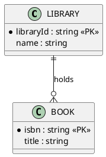
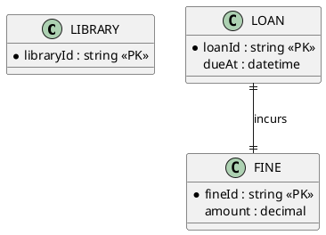
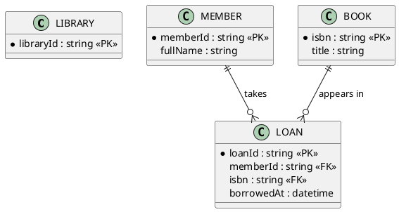

# PlantUML to JSON Schema

`puml_to_json_schema.py` reads a PlantUML class diagram and writes a draft
2020-12 JSON Schema that describes the shape of the root entity. The PlantUML
model is the input; an optional JSON configuration file overrides the root class
and the generated names. The generator emits structure only: property names,
property types, and which relationships are required. It emits no value
constraints, because those belong to the layer that consumes the schema.

`example-model.puml` is a fictional library-lending model. It exists so the
tests and the golden fixture carry no real data.

## Requirements

Python 3.10 or later. The generator uses the standard library only, so it has no
dependencies to install. One test needs the `jsonschema` package and skips when
it is absent.

## Generate the schema

```powershell
python puml_to_json_schema.py example-model.puml --output generated/example.schema.json
```

The command prints nothing on success and exits 0. It creates the output
directory when that directory does not exist.

## Configure the model mappings

`--config` accepts an optional JSON file. The file names the root class and
overrides generated entity and property names:

```json
{
  "root_entity": "MEMBER",
  "entity_names": {
    "MEMBER": "Borrower",
    "BOOK": "Tome"
  },
  "relationship_names": {
    "MEMBER": {
      "LOAN": "activeLoans"
    }
  }
}
```

```powershell
python puml_to_json_schema.py example-model.puml --output generated/borrower.schema.json --config borrower-config.json
```

The top-level `$ref` becomes `#/$defs/Borrower`. `Member` becomes `Borrower`
everywhere, including the `$defs` key. `Book` becomes `Tome`, including inside
each `$ref` that points at it. `Member.loans` becomes `Borrower.activeLoans`.

All three keys are optional:

- `root_entity` names the class whose entity the top-level `$ref` points at. It
  may also name an entity. When omitted, `LIBRARY` is the root if the model
  declares it. Otherwise the root is the first class declared with no incoming
  relationship.
- `entity_names` maps a class name to the name used in `$defs`.
- `relationship_names` maps a parent class and child class to the property name
  that carries the reference. It uses both class names as the key, because one
  label can appear on several relationships.

Each value must be an identifier: a letter or `_`, then letters, digits, or `_`.
Without an override, a class name becomes PascalCase
(`ORDER_LINE` becomes `OrderLine`). A relationship label becomes lowerCamelCase
(`appears in` becomes `appearsIn`). The example model keeps its built-in names,
so `example-config.json` reproduces the golden schema byte for byte.

The generator rejects a configuration that could silently produce a wrong
schema:

- unknown top-level keys, duplicate keys, or a document that is not an object
- a class, root, or relationship mapping that the model does not contain
- a name that is not an identifier
- two classes that resolve to one `$defs` name
- two properties that resolve to one name in the same entity

The same collision check covers the model itself. An attribute and a
relationship that produce one property name are an error. So is a relationship
declared twice.

## The document

The top level holds `$schema`, a `$ref` to the root entity, and `$defs`. `$defs`
holds one entry per model class, sorted by name. Every entry is an object whose
properties follow the attribute order in the model.

A relationship that ends in `o{` becomes an array of `$ref`. A relationship that
ends in `o|` or `||` becomes a single `$ref`. A property appears in `required`
only when both ends of the relationship are `||`, so `required` lists the
relationships the model marks as mandatory and nothing else.

### Foreign keys

An `<<FK>>` attribute disappears when containment already carries the
relationship. The generator treats the FK target as the one class whose `<<PK>>`
has the same attribute name. It drops the attribute when that class sits above
the declaring class on every containment path from the root.

The attribute stays a plain property whenever the rule cannot prove redundancy.
That covers a sibling reference, a target above only on another path of a shared
definition, an ambiguous target, and an attribute with no matching `<<PK>>`.
Keeping it is deliberate, because dropping it would lose the link. A misspelled
FK name therefore keeps the property.

In `example-model.puml` the root is `Library`. `Book` is above `Loan` on every
path, so `Loan.isbn` is dropped. `Member` is outside that containment tree, so
`Loan.memberId` stays.

The containment tree starts at the root described in
[Configure the model mappings](#configure-the-model-mappings): `LIBRARY` when
declared, otherwise the first class declared with no incoming relationship.
Only the root's subtree describes instances, so generate with another
`root_entity` for a document rooted elsewhere.

Types map as follows:

| PlantUML   | JSON Schema                                 |
| ---------- | ------------------------------------------- |
| `string`   | `{"type": "string"}`                        |
| `boolean`  | `{"type": "boolean"}`                       |
| `integer`  | `{"type": "integer"}`                       |
| `decimal`  | `{"type": "number"}`                        |
| `date`     | `{"type": "string", "format": "date"}`      |
| `datetime` | `{"type": "string", "format": "date-time"}` |

The document contains no other keywords. There is no `pattern`, `enum`,
`minLength`, `default`, `description`, or `additionalProperties`. The emitted
keywords are `$schema`, `$ref`, `$defs`, `type`, `properties`, `items`,
`format`, and `required`.

## Examples

Each example below is a complete model. Save the input, run the command, and you
get the output shown.

### One to many

A library holds many books. The relationship ends in `o{`, so `Library` gets an
array of references.



```powershell
python puml_to_json_schema.py one-to-many.puml --output one-to-many.json
```

```json
{
  "$schema": "https://json-schema.org/draft/2020-12/schema",
  "$ref": "#/$defs/Library",
  "$defs": {
    "Book": {
      "type": "object",
      "properties": {
        "isbn": {
          "type": "string"
        },
        "title": {
          "type": "string"
        }
      }
    },
    "Library": {
      "type": "object",
      "properties": {
        "libraryId": {
          "type": "string"
        },
        "name": {
          "type": "string"
        },
        "books": {
          "type": "array",
          "items": {
            "$ref": "#/$defs/Book"
          }
        }
      }
    }
  }
}
```

### One to one, and `required`

Both ends of `LOAN ||--|| FINE` are `||`, so `Loan` gets a single reference and
the property name is added to `required`.



```json
{
  "$schema": "https://json-schema.org/draft/2020-12/schema",
  "$ref": "#/$defs/Library",
  "$defs": {
    "Fine": {
      "type": "object",
      "properties": {
        "fineId": {
          "type": "string"
        },
        "amount": {
          "type": "number"
        }
      }
    },
    "Library": {
      "type": "object",
      "properties": {
        "libraryId": {
          "type": "string"
        }
      }
    },
    "Loan": {
      "type": "object",
      "properties": {
        "loanId": {
          "type": "string"
        },
        "dueAt": {
          "type": "string",
          "format": "date-time"
        },
        "fine": {
          "$ref": "#/$defs/Fine"
        }
      },
      "required": [
        "fine"
      ]
    }
  }
}
```

`LIBRARY` takes no part in the relationship. It is declared so the top-level
`$ref` resolves, because the document points at the `LIBRARY` class by default.
Set `root_entity` to choose another root.

### Many to many through an intersecting class

The generator emits one property per declared relationship, so a many-to-many is
modelled with a class in the middle and two one-to-many relationships.



The `$defs` entries below are what this model produces. The `Library` entry is
left out to keep the example short.

```json
{
  "Book": {
    "type": "object",
    "properties": {
      "isbn": {
        "type": "string"
      },
      "title": {
        "type": "string"
      },
      "loans": {
        "type": "array",
        "items": {
          "$ref": "#/$defs/Loan"
        }
      }
    }
  },
  "Loan": {
    "type": "object",
    "properties": {
      "loanId": {
        "type": "string"
      },
      "memberId": {
        "type": "string"
      },
      "isbn": {
        "type": "string"
      },
      "borrowedAt": {
        "type": "string",
        "format": "date-time"
      }
    }
  },
  "Member": {
    "type": "object",
    "properties": {
      "memberId": {
        "type": "string"
      },
      "fullName": {
        "type": "string"
      },
      "loans": {
        "type": "array",
        "items": {
          "$ref": "#/$defs/Loan"
        }
      }
    }
  }
}
```

`Member` and `Book` each carry a `loans` array, so both directions of the
many-to-many are navigable. `Loan` holds `memberId` and `isbn` as plain string
properties, because the generator emits the reference on the parent side of each
relationship. The intersecting class carries the foreign keys itself. Neither
target is above `Loan` in this model, so the FK rule keeps both.

## The supported PlantUML subset

The parser accepts the following and rejects everything else with a line number:

- `@startuml` and `@enduml`, each exactly once, with nothing after `@enduml`
- comments that start with `'`
- the styling lines `left to right direction`, `hide methods`, and `hide stereotypes`
- `skinparam` lines, and `skinparam` blocks closed with `}`
- `class NAME {` or `class NAME <<Stereotype>> {`, followed by one attribute per line and a closing `}`
- attributes of the form `name : type`, with an optional leading `*` and an optional `<<PK>>` or `<<FK>>` marker
- relationships of the form `PARENT ||--o{ CHILD : label`, where each cardinality is `||`, `o|`, or `o{`

A class body must span several lines. `class LOAN { loanId : string }` on one
line is rejected, because the parser only recognises a class line that ends with
the opening brace.

## Extending the model

`TYPE_MAP` holds the attribute type rules. Names come from three places, in
precedence order:

1. The `--config` overrides `entity_names` and `relationship_names`.
2. The built-in `ENTITY_NAMES` and `RELATIONSHIP_NAMES` tables, which describe
   the example model and keep its output stable.
3. A name derived from the class name (`ORDER_LINE` becomes `OrderLine`) or the
   relationship label (`appears in` becomes `appearsIn`).

A class or relationship outside the built-in tables needs no code change. Add it
to the model, then add an override only where the derived name is not the one
you want. Labels such as `has` or `includes` are ambiguous, so a relationship
override names both the parent and the child class.

The generator emits a property only on the parent side of a relationship. A
navigable reverse direction needs its own declared relationship and its own
override entry.

`root_entity` selects the entity that the top-level `$ref` points at, so
changing the entry point needs no constant edit.

`PK` and `FK` markers do not change a property's schema on their own. A
`<<FK>>` that points at an entity above the holder on every containment path is
dropped, as described in [Foreign keys](#foreign-keys). A `<<PK>>` stays a plain
property, and neither marker affects `required`.

## Command line contract

`--output` is required and `--config` is optional. The generator refuses an
output path that resolves to the input file, including a path that differs only
in letter case.

Every failure prints one line to stderr and exits 2. The forms are:

- `path: line N: message` for a problem in the model
- `path: message` for an unreadable input, invalid UTF-8, an unwritable output,
  or a problem in the configuration file
- `puml_to_json_schema.py: message` for a missing or invalid argument

A failure never prints a traceback.

## Determinism

The output is byte-identical across runs and across `PYTHONHASHSEED` values.
`$defs` and `required` are sorted, attribute order comes from the model, and the
file is written as UTF-8 with LF line endings and two-space indentation.

`tests/fixtures/example.schema.golden.json` pins that output. The repository sets
`* -text` in `.gitattributes` so Git does not convert line endings on checkout,
which would otherwise break the byte comparison on Windows.

## Verify

```powershell
python -m unittest -v
```

The suite runs 96 tests. It covers the parser errors, the emission shapes, and
the example model against the golden fixture. It also covers the configuration
overrides and their errors, the foreign-key rule, the command line contract, and
determinism.

## Layout

```
example-config.json                a configuration that reproduces the defaults
example-model.puml                 the input model
puml_to_json_schema.py             the generator
generated/example.schema.json      the generated schema
tests/fixtures/                    the golden schema and the parser fixtures
test_puml_to_json_schema.py        the tests
```

## Known limitations

These are defects in the current generator rather than intended behaviour:

- A left-hand `o{` is validated and then ignored, so write relationships from the parent to the child.
- An output path that is a hardlink to the input is not recognised as the same file, so the input is overwritten.
